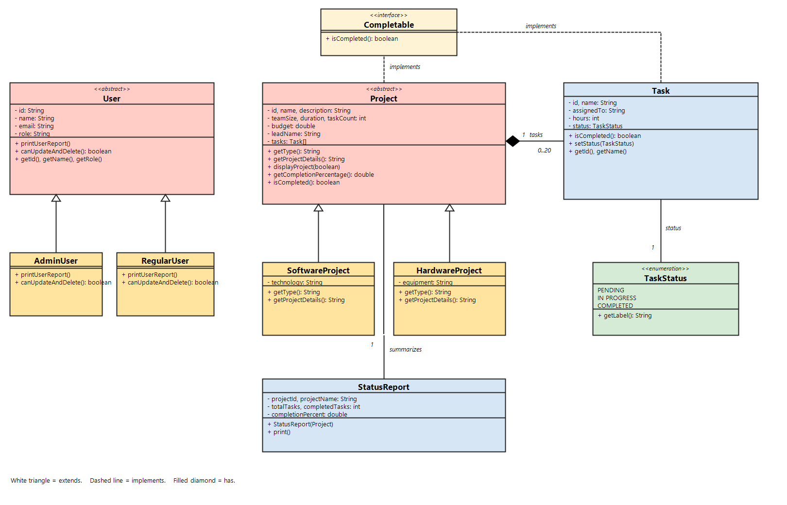

# Task Management System

## Project Overview

**Technology Stack:** Java 21 (LTS), IntelliJ IDEA Community Edition, JUnit 5

This lab builds **Lab 1 – Java Basics** by refactoring the **Project/Task Management System** for **cleaner, safer, and testable code**.

You'll apply **exception handling**, **SOLID principles**, and **unit testing** using JUnit 5, while maintaining version control with Git.

All functionality from Lab 1 (Project creation, Task management, Completion averages) remains, but now enhanced with:

- Custom exceptions for invalid inputs
- Refactored, modular code with better naming and organization
- Basic JUnit tests for core functions
- Git repository setup and proper commit workflow

All data remains in memory using **arrays** (no external DB). Future labs will introduce **collections** and **file persistence**.

## Project Objectives

By completing this lab, you will be able to:

- Apply **clean code principles** (SOLID, naming conventions, method modularity).
- Implement **exception handling** using try-catch blocks and custom exceptions.
- Refactor Lab 1 code for improved readability and maintainability.
- Write and run **JUnit unit tests** for methods like task status updates and completion calculations.
- Use **Git** for source control: initialize repositories, commit changes, create branches, and merge.
- Evaluate code quality through consistent indentation, comments, and naming.
- Handle invalid user inputs gracefully through custom exception messages.
- Prepare the system for future enhancements (Week 3 will replace arrays with collections).

## System Features Overview

Your **Project/Task Management System** should now include error handling, refactoring, and testing enhancements for these five core features:

### Feature 1: Project Catalog Management

- Same as Lab 1 (creating and listing projects).
- Add validation via custom exceptions (e.g., InvalidProjectDataException).
- Enforce unique project IDs and positive budgets.

### Feature 2: Task Operations

- Handle invalid task assignments gracefully (throw TaskNotFoundException).
- Refactor task creation/update methods for clarity.
- Add unit tests for task status updates and progress calculation.

### Feature 3: User Management

- Refactor user logic to separate responsibilities (e.g., UserService).
- Validate email and role inputs through exceptions.
- Use Git branches for adding new user roles (clean commit history).

### Feature 4: Status Processing & Reporting

- Add validation for projects with no tasks (throw EmptyProjectException).
- Test average calculation methods via JUnit.
- Refactor printing logic to utility methods.

### Feature 5: Menu Navigation & User Experience

- Improve input validation with exception handling.
- Display user-friendly error messages for invalid entries.
- Ensure menu loops remain stable under exceptions.

## Console UI Examples

Below are sample enhanced console outputs showing error handling and testing feedback.

### 1. Main Menu

```
╔════════════════════════════════════════════╗
║     JAVA PROJECT MANAGEMENT SYSTEM         ║
╚════════════════════════════════════════════╝

Current User:  Alice Johnson (Admin)

Main Menu:
-----------
1. Manage Projects
2. Manage Tasks
3. View Status Reports
4. Switch User
5. Exit

Enter your choice: _
```

### 2. Invalid Input Handled via Exception

```
Enter project ID: P999
❌ Error: ProjectNotFoundException – Project ID 'P999' does not exist.
Please try again.

Enter project ID: P001
✓ Project 'Alpha Tracker' loaded successfully.
```

### 3. Add Task – Validation

```
╔════════════════════════════════════════════╗
║               ADD NEW TASK                 ║
╚════════════════════════════════════════════╝

Enter task name: Implement API
Enter status (Pending/In Progress/Completed): In Progress

✓ Task 'Implement API' successfully added to Project P001.
```

### 4. Exception During Task Update

```
Enter task ID: T999
❌ Error: TaskNotFoundException – Task 'T999' was not found in the project.

Operation aborted. Returning to task menu...
```

### 5. Status Report Display

```
╔════════════════════════════════════════════╗
║            PROJECT STATUS REPORT           ║
╚════════════════════════════════════════════╝

PROJECT ID | PROJECT NAME      | TASKS | COMPLETED | PROGRESS (%)
-----------------------------------------------------------------
P001       | Alpha Tracker     |   4   |    3      |   75%
P002       | IoT Sensor Kit    |   2   |    1      |   50%
-----------------------------------------------------------------
AVERAGE COMPLETION: 62.5%

✓ Report generated successfully.
```

### 6. Git Commit Workflow (Example Output)

```bash
$ git init
$ git add .
$ git commit -m "Refactor: Added custom exceptions and cleaned class structure"
$ git branch feature/testing
$ git checkout feature/testing
$ git add src/test
$ git commit -m "Test: Added JUnit test for progress calculation"
$ git checkout main
$ git merge feature/testing
```

### 7. JUnit Test Example

```java
@Test
void testCalculateCompletionPercentage() {
    Project p = new SoftwareProject("P001", "Alpha Tracker", 5, 15000);
    p.addTask(new Task("T001", "Setup DB", "Completed"));
    p.addTask(new Task("T002", "Design UI", "In Progress"));

    double result = p.calculateCompletionPercentage();
    assertEquals(50.0, result);
}
```

## Expected User Workflows

### Workflow 1: Refactor and Run

User opens existing Lab 1 project → Refactors code → Runs updated program → Confirms all previous features still work.

### Workflow 2: Exception Handling

User enters invalid data (e.g., negative budget) → System throws custom exception → Displays error → Returns to menu without crashing.

### Workflow 3: Unit Testing

User writes JUnit tests for calculateCompletionPercentage() → Runs tests → All pass with green indicators.

### Workflow 4: Git Versioning

User initializes Git repo → Makes commits after refactoring and testing → Creates branch for new exceptions → Merges cleanly.

## User Stories

### Epic 1: Code Refactoring

**US-1.1:** Refactor Class Design — **As a developer** I want to simplify methods and names so that the code is easier to maintain.

**Acceptance Criteria:**

- No duplicate logic.
- Descriptive method and variable names.
- Single Responsibility per class.

**Technical Requirements:**

- Apply SOLID principles (Single Responsibility, Open/Closed).
- Split large methods into smaller ones.
- Use meaningful naming and comments.

### Epic 2: Exception Handling

**US-2.1:** Handle Invalid Inputs — **As a system** I want to catch invalid user inputs so that the program does not crash.

**Acceptance Criteria:**

- Throws custom exceptions (e.g., InvalidInputException, TaskNotFoundException).
- Displays clear error messages.
- Logs errors to console gracefully.

**Technical Requirements:**

- Use try-catch-finally blocks.
- Create custom exception classes in utils.exceptions.
- Handle validation centrally via ValidationUtils.

### Epic 3: Testing Fundamentals

**US-3.1:** Test Completion Calculation — **As a developer** I want to verify that completion percentages are accurate.

**Acceptance Criteria:**

- At least 3 JUnit tests for different cases (no tasks, partial, all completed).
- All tests pass successfully.

**Technical Requirements:**

- Add src/test/java/ directory.
- Use JUnit 5 annotations (@Test, @BeforeEach).
- Assertions: assertEquals, assertThrows.

### Epic 4: Git Version Control

**US-4.1:** Version Code Changes — **As a developer** I want to track changes and refactors using Git so that my code history is maintained.

**Acceptance Criteria:**

- Repository initialized and linked to GitHub.
- Minimum 3 meaningful commits.
- One feature branch created and merged.

**Technical Requirements:**

- Run git init, git add ., git commit.
- Use branches (e.g., feature/exceptions).
- Merge via git merge.

### Epic 5: Menu Error Handling

**US-5.1:** Handle Menu Errors — **As a user** I want the menu to remain functional after invalid inputs.

**Acceptance Criteria:**

- Program does not crash on invalid entry.
- Error message and retry prompt displayed.

**Technical Requirements:**

- Use input validation and try-catch in ConsoleMenu.
- Implement looping until valid entry is provided.

## Class diagram

The diagram shows inheritance and the links between classes.



How to read it:

- A white triangle means **extends**. `SoftwareProject` and `HardwareProject` extend `Project`. `AdminUser` and `RegularUser` extend `User`.
- A dashed line means **implements**. `Project` and `Task` both implement `Completable`.
- A filled diamond means **has**. One project has from 0 to 20 tasks. Each task has one status. One status report summarizes one project.

A longer note is in [docs/designDecisions.md](docs/designDecisions.md).

## Project Structure

```
project-management-system/
│
├── src/
│   ├── Main.java
│   ├── models/
│   │   ├── Project.java
│   │   ├── SoftwareProject.java
│   │   ├── HardwareProject.java
│   │   ├── Task.java
│   │   ├── User.java
│   │   ├── RegularUser.java
│   │   ├── AdminUser.java
│   │   └── StatusReport.java
│   │
│   ├── interfaces/
│   │   └── Completable.java
│   │
│   ├── services/
│   │   ├── ProjectService.java
│   │   ├── TaskService.java
│   │   └── ReportService.java
│   │
│   ├── utils/
│   │   ├── ConsoleMenu.java
│   │   ├── ValidationUtils.java
│   │   └── exceptions/
│   │       ├── InvalidInputException.java
│   │       ├── ProjectNotFoundException.java
│   │       ├── TaskNotFoundException.java
│   │       └── EmptyProjectException.java
│   │
│   └── test/java/
│       └── ProjectTests.java
│
├── docs/
│   ├── class-diagram.png
│   └── designDecisions.md
│
├── pom.xml
└── README.md
```

## Implementation Phases

### Phase 1: Refactor Existing Code (1–2 hours)

**Tasks:**

- Review Lab 1 code.
- Apply SOLID and naming best practices.
- Separate concerns into services and utils.

**Deliverables:** Refactored, readable code with consistent structure.

### Phase 2: Add Exception Handling (2 hours)

**Tasks:**

- Create custom exception classes.
- Add try-catch logic around input operations.

**Deliverables:** Program handles invalid inputs gracefully without crashing.

### Phase 3: JUnit Testing (2 hours)

**Tasks:**

- Write unit tests for key methods.
- Run tests in IntelliJ using JUnit 5.

**Deliverables:** All tests passing; test coverage for critical logic.

### Phase 4: Git Version Control (1–2 hours)

**Tasks:**

- Initialize Git repository.
- Commit changes incrementally.
- Push to GitHub and create branches for features.

**Deliverables:** Organized commit history with proper branch merging.

## Minimum Requirements Checklist

- JDK 21 and IntelliJ IDEA installed and configured
- Refactored code from Lab 1 with clean structure
- At least 3 custom exception classes implemented
- All exceptions properly handled via try-catch
- At least 3 JUnit test cases passing successfully
- Meaningful variable and method names used throughout
- Methods follow Single Responsibility Principle
- Git repository initialized and hosted on GitHub
- At least 3 commits with clear messages
- Feature branch created and merged successfully
- Console menu remains functional after errors
- README updated with refactoring and Git instructions
- All previous Lab 1 features remain functional

## Grading Rubric

| **Criteria** | **Points** | **Excellent (90–100%)** | **Good (75–89%)** | **Satisfactory (60–74%)** |
| --- | --- | --- | --- | --- |
| Code Refactoring & Clean Code | 20 | All classes follow SOLID principles; excellent naming; no duplication; methods concise and readable | Good structure; minor naming issues; few duplications | Some refactoring done; inconsistent style and naming |
| Exception Handling | 20 | Robust try-catch blocks; custom exceptions implemented; error handling enhances stability | Basic exception handling; covers main failure points | Minimal exception use or only generic catch blocks |
| Testing & Coverage | 20 | ≥ 3 comprehensive JUnit tests; high coverage; clear assertions; edge cases tested | Some tests working; limited coverage; minor failures | Few or incomplete tests with weak assertions |
| Git Version Control | 15 | Proper repo structure; multiple commits with messages; branches merged cleanly; frequent pushes | Repo created; few commits; limited branching | Repo missing or poor commit history |
| Functionality & Stability | 15 | All features functional with graceful error handling; clean UI flow; stable execution | Minor bugs or UI issues; mostly functional | Core features work but frequent errors or crashes |
| Data Structures & Algorithms (DSA) | 10 | Efficient data organization and retrieval within refactored code; optimized logic in tests; shows understanding of algorithmic efficiency | Proper use of data structures in refactoring; minor inefficiencies | Limited or inefficient data handling; weak algorithmic structure |
| **Total** | **100** |  |  |  |

## Submission Requirements

### Required Deliverables:

- Public GitHub Repository containing:
  - All source code (/src, /test)
  - README.md with setup and Git instructions
  - JUnit test results screenshot (optional)
- **Documentation** must include:
  - Setup and run instructions
  - Feature summary mapped to user stories
  - Class diagram and refactoring explanation
  - Commit log snapshot showing version control usage

### Submission Link:

Please fill out this form (**insert actual form link here**)

## Testing the Application

Documented results below match what this project actually implements (arrays in memory, IDs like `PRJ001` / `TSK001`, services + `ConsoleMenu`, JUnit 5 + Mockito).

### Test Scenario 1: Refactored Project Creation

**Steps**

1. Run `Main` (IntelliJ or `mvn -q compile` then `java -cp target/classes Main`).
2. Main menu → **1. Manage Projects** → **1. Add Project**.
3. Choose Software, then enter name, description, duration, budget, team size, lead, technology.

**Result — Done**

- `SoftwareProject` / `HardwareProject` constructors set private fields; callers use getters only.
- `Project` assigns the next ID with `String.format("PRJ%03d", nextNumber)` (sample data already loads `PRJ001`–`PRJ005`, so a new project is `PRJ006`).
- Banner and success lines print through `ConsoleMenu`; `Main` only wires services.

**Example**

```text
╔════════════════════════════════════════════╗
║              MANAGE PROJECTS               ║
╚════════════════════════════════════════════╝

1. Add Project
2. Browse Project Catalog
3. <<Back

Enter your choice: 1
... (Software + details) ...
✓ Project 'My App' created with ID PRJ006.
```

### Test Scenario 2: Add Task with Exception Handling

**Steps**

1. Main menu → **2. Manage Tasks** → **1. Add Task** (or add from a project details screen).
2. Enter a missing project id such as `PRJ999`.
3. Enter a valid id (for example `PRJ001`) and task details.

**Result — Done**

- `promptForProject` throws `ProjectNotFoundException` when the id is missing; `printError` shows it and asks again — the menu does not exit.
- A valid project creates a task via `TaskService.addTask(...)` with a generated `TSK` id.
- Updating/removing a missing task throws `TaskNotFoundException`.

**Example**

```text
Enter project ID (or 0 to go back): PRJ999
 Error: ProjectNotFoundException – Project ID 'PRJ999' does not exist.
Please try again.

Enter project ID (or 0 to go back): PRJ001
✓ Task 'Design' successfully added to Project PRJ001.
```

```text
Enter task ID: TSK999
 Error: TaskNotFoundException – Task 'TSK999' was not found in the project.
```

### Test Scenario 3: View Projects (After Refactoring)

**Steps**

1. Main menu → **1. Manage Projects** → **2. Browse Project Catalog**.
2. Choose **1. View All Projects**, or Software / Hardware filters.
3. Open **View Project Details** for one id.

**Result — Done**

- Listing goes through `ProjectService` (`printAll`, `printByType`, `printByBudget`).
- Details use getters / polymorphism (`getType()`, `getProjectDetails()`), not raw fields.
- Each project keeps its own task array; opening a project shows only that project’s tasks (no duplicate rows from another project).

**Example**

```text
PROJECT CATALOG → View All Projects

PRJ001 | Alpha Tracker   | Software | ...
PRJ002 | IoT Sensor Kit  | Hardware | ...
PRJ003 | Mobile Checkout | Software | ...
...

Enter project ID: PRJ001
 → PROJECT DETAILS: PRJ001 (tasks and completion for Alpha Tracker only)
```

### Test Scenario 4: Calculate Completion Percentage (Refactored Logic)

**Steps**

1. Main menu → **3. View Status Reports** (all projects + average).
2. Or open a project’s details to see that project’s progress.
3. For a project with zero tasks, open details / completion path and confirm the empty-project path.

**Result — Done**

- Per-project percent: `TaskService.calculateCompletionPercentage(project)` → completed / total × 100.
- Catalog average: `ReportService` builds `StatusReport` rows and prints `AVERAGE COMPLETION`.
- Zero tasks: `EmptyProjectException` (“Project 'PRJ005' has no tasks.” for Payroll Portal when completion is requested).

**Example**

```text
PROJECT ID | PROJECT NAME      | TASKS | COMPLETED | PROGRESS (%)
-----------------------------------------------------------------
PRJ001     | Alpha Tracker     |   3   |    1      |   33.33%
PRJ002     | IoT Sensor Kit    |   2   |    1      |   50.00%
...
AVERAGE COMPLETION: xx.xx%
```

JUnit check (same formula):

```java
// createProject / addTask / calculateCompletion in ProjectTests
taskService.addTask(project, "Design", "", TaskStatus.COMPLETED, 2);
taskService.addTask(project, "Build", "", TaskStatus.PENDING, 3);
assertEquals(50.0, taskService.calculateCompletionPercentage(project));
```

### Test Scenario 5: Exception Handling for Invalid Inputs

**Steps**

1. At any numeric prompt, type a letter (for example `abc`).
2. Enter budget `0` or a negative team size / duration / hours.
3. Confirm the menu stays open and prompts again.

**Result — Done**

- `ValidationUtils` throws `InvalidInputException` for bad numbers, empty text, bad email, budget ≤ 0, etc.
- `ConsoleMenu` catches, prints `Error: InvalidInputException – ...`, then `Please try again.`
- Missing project/task ids use `ProjectNotFoundException` / `TaskNotFoundException`; empty completion uses `EmptyProjectException`.

**Example**

```text
Enter your choice: abc
Please enter a number.

Enter minimum budget: 0
 Error: InvalidInputException – Budget must be greater than 0.
Please try again.
```

### Test Scenario 6: Run JUnit Tests

**Steps**

1. Open `src/test/java/ProjectTests.java` or run `mvn test`.
2. Run the class (JUnit 5 + Mockito).

**Result — Done**

| Test | What it proves |
| --- | --- |
| `createProject` | Real `SoftwareProject` stored in real `ProjectService`; name/type/count asserted |
| `addTask` | Task added onto the project; `getTaskCount() == 1` |
| `calculateCompletion` | One of two completed → `50.0` |
| `missingTaskThrows` | Mocked `ProjectService.getCount() == 0` → `TaskNotFoundException` |
| `adminCanDeleteProject` | `AdminUser.canUpdateAndDelete()` is `true` |
| `regularUserCannotDeleteProject` | `RegularUser.canUpdateAndDelete()` is `false` |

**Example**

```text
$ mvn test
...
[INFO] Tests run: 6, Failures: 0, Errors: 0, Skipped: 0
[INFO] BUILD SUCCESS
```

### Test Scenario 7: Git Commit and Branch Workflow

**Steps**

1. Work was versioned on GitHub (repo already existed; no second `git init`).
2. Feature branches for Lab 2 phases, then merge into `main`.

**Result — Done**

| Branch | Purpose |
| --- | --- |
| `feature/refactor` | Phase 1 — services / single responsibility |
| `feature/exceptions` | Phase 2 — custom exceptions + menu try/catch |
| `feature/testing` | Phase 3 — JUnit tests |
| `feature/taskvalidation` | Follow-up — Maven `src/test`, Mockito, README |

Merged into `main`: `feature/refactor`, `feature/exceptions`, `feature/testing`, `feature/taskvalidation`.

**Example commit history**

```text
Move tests under Maven src/test and document JUnit/Mockito coverage.
Add Maven so the tests run with JUnit and Mockito.
Merge feature/testing into main.
Merge feature/exceptions into main.
Merge feature/refactor into main.
Add JUnit tests for completion, task status, and budget.
exception handling
Add checked exceptions so bad input stays in the menu.
Refactor each class to one job so the menu only reads input.
```

### Test Scenario 8: Git Push and Remote Verification

**Steps**

1. Push all workflow branches to GitHub.
2. Confirm README, `.gitignore`, `src/`, and tests are on the remote.

**Result — Done**

- Remote: [https://github.com/Sergeb250/Task-Mgt-System-II.git](https://github.com/Sergeb250/Task-Mgt-System-II.git)
- Branches on remote: `main`, `feature/refactor`, `feature/exceptions`, `feature/testing`, `feature/taskvalidation`
- Clone path for a teammate:

```bash
git clone https://github.com/Sergeb250/Task-Mgt-System-II.git
cd Task-Mgt-System-II
mvn test
mvn -q compile
java -cp target/classes Main
```

### Test Scenario 9: Code Cleanliness and Comments Check

**Steps**

1. Review `Project.java`, `Task.java`, `Main.java`, services, and `ConsoleMenu`.
2. Check naming, indentation, and dead code.

**Result — Done**

- `Main` only builds services and starts the menu (no business logic).
- Models keep fields private; services own arrays and operations; utils own I/O and validation.
- Short class/method comments describe intent (for example on `Project`, `TaskService`, exception types).
- No `ArrayList`; unused Lab 1 guide files were removed; test sources live under Maven `src/test/java`.
